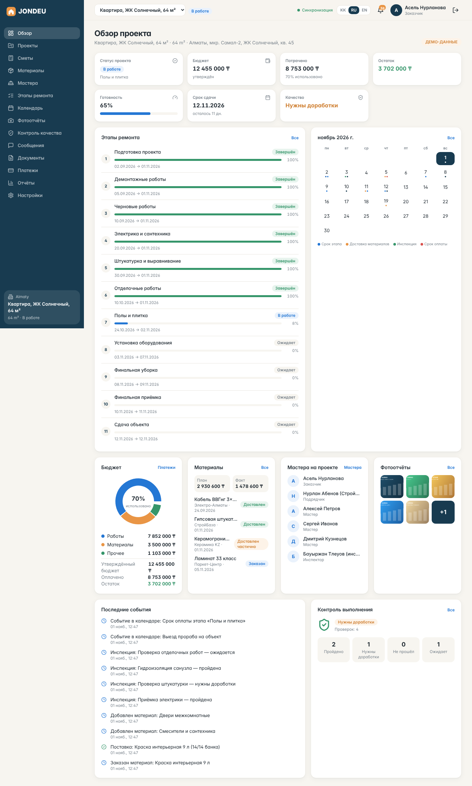

# JONDEU — Жөндеу оңай. / Home renovation made simple.

Платформа управления ремонтом **от заявки до сдачи объекта**: мастера, смета, этапы, материалы, платежи, фотоотчёты, чат и контроль качества.
Ключевая идея: **один backend — единый источник правды**. Мобильное приложение (Flutter) и веб-дашборд (Next.js) показывают одни и те же данные, а любое изменение
(смета, этап, платёж, сообщение) доезжает до всех участников проекта через WebSocket за доли секунды.

```
 Flutter (клиент + мастер)  ─┐                         ┌─ PostgreSQL 16 (Flyway)
 Next.js dashboard          ─┼─ REST /api/v1 + WS /ws ─┤  Spring Boot 3.3 / Java 21 (modular monolith)
 Admin (в дашборде)         ─┘                         └─ файловое хранилище (local | S3-совместимое)
```

## Как работает синхронизация
1. Любая мутация в сервисе пишет доменное событие в `project_events` **в той же транзакции** (журнал не может разойтись с данными).
2. **После коммита** событие рассылается по WebSocket подписчикам проекта (доступ проверяется при подписке) — `ProjectEvents`, `WsHub`.
3. Клиенты не патчат локальное состояние (иначе бизнес-логика дублировалась бы): они **инвалидируют затронутые запросы** и перечитывают данные с сервера.
   Веб — `RealtimeProvider` (TanStack Query), мобильное — `RtNotifier` (Riverpod).
4. После обрыва связи клиент переподключается (exponential backoff) и догоняет: `GET /projects/{id}/events?after=<seq>`.
5. Все суммы, прогресс и статусы считает **только backend** (`GET /projects/{id}/overview`) — клиенты ничего не пересчитывают.

Проверено: `RealtimeSyncTest` (два WS-клиента + посторонний) и сквозная проверка в браузере (изменение этапа подрядчиком появляется у заказчика без перезагрузки, ~70 мс).

## Быстрый старт

### Вариант A — Docker
```bash
cp .env.example .env     # задайте DB_PASSWORD и JWT_SECRET
docker compose up --build
# web: http://localhost:3000   API/Swagger: http://localhost:8080/swagger-ui.html
```
### Вариант B — локально
```bash
# 1) PostgreSQL 16:  createdb jondeu; пользователь jondeu/jondeu (или переменные DB_URL, DB_USER, DB_PASSWORD)
cd backend && mvn spring-boot:run            # профиль dev: демо-данные, sandbox-платежи, OTP-код в ответе
cd web && npm ci && npm run dev              # http://localhost:3000   (NEXT_PUBLIC_API_URL, по умолчанию :8080)
cd mobile && flutter pub get && flutter run --dart-define=API_URL=http://10.0.2.2:8080   # эмулятор Android
```
**Демо-аккаунты** (только профиль `dev`, пароль `demo1234`): заказчик `+7 701 000 00 01`, подрядчик (СтройКомфорт) `+7 701 000 00 09`, мастера `…04…08`, инспектор `…11`, администратор `…99`.
Демо-проект: «Квартира, ЖК Солнечный, 64 м²» — бюджет 12 455 000 ₸, оплачено 8 753 000 ₸, остаток 3 702 000 ₸, готовность 65 %.

## Тесты
| Часть | Команда | Что покрыто |
|---|---|---|
| backend | `cd backend && mvn verify` | 26 тестов на реальном PostgreSQL (embedded): калькулятор смет, взвешенный прогресс, **сквозной сценарий из 16 шагов**, RBAC/изоляция проектов, ротация refresh-токенов, идемпотентность и **гонка платежей**, подпись callback, WebSocket-синхронизация, демо-данные |
| web | `cd web && npm test && npm run typecheck && npm run build` | i18n (полнота kk/ru/en), форматирование, валидация, API-клиент (single-flight refresh), компоненты |
| mobile | `cd mobile && flutter analyze && flutter test` | i18n, нормализация телефона, refresh-ротация, формы, защита от переплаты, idempotency key |

## Структура
`backend/` Spring Boot (модули: identity, projects, estimates, stages, materials, payments, messaging, media, inspections, calendar, notifications, masters, admin, sync, demo) ·
`web/` Next.js 14 + Tailwind + TanStack Query + RHF/Zod + Recharts · `mobile/` Flutter + Riverpod + Dio · `docs/` (OpenAPI, платежи, статус).

## Безопасность (кратко)
JWT access (30 мин) + **ротация refresh-токенов с обнаружением повторного использования**; BCrypt; RBAC на уровне проекта (`ProjectAccess`, 404 для посторонних, 403 для нехватки прав);
rate limit на `/auth`; валидация загрузок по magic bytes, подписанные временные URL на файлы; финансы — `BigDecimal`, append-only ledger, блокировка строки проекта, idempotency;
секреты только из переменных окружения; в `prod` профиле выключены sandbox-платежи, демо-данные и dev-OTP.

## Скриншоты
Веб-дашборд на демо-данных (`docs/screenshots/`, 1440 px; последний файл — узкий экран):

Остальные: `00-login`, `02-projects`, `03-estimates`, `04-stages`, `05-materials`, `06-calendar`, `07-photos`, `08-quality`, `09-messages`, `10-documents`, `11-payments`, `12-masters`, `13-reports`, `14-settings`, `15-dashboard-mobile-width`.

## Документация
`docs/STATUS.md` — **честный статус реализации и следующие шаги** · `docs/PAYMENTS.md` · `docs/openapi.json` (и `/swagger-ui.html`).
